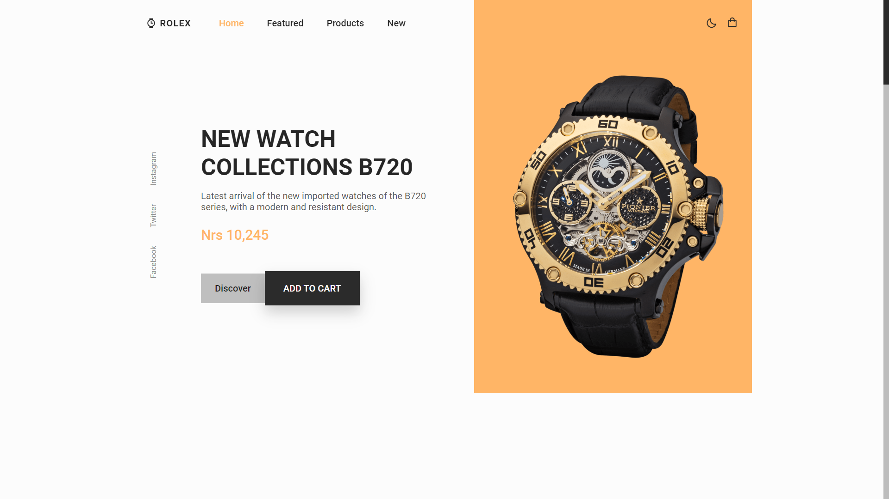
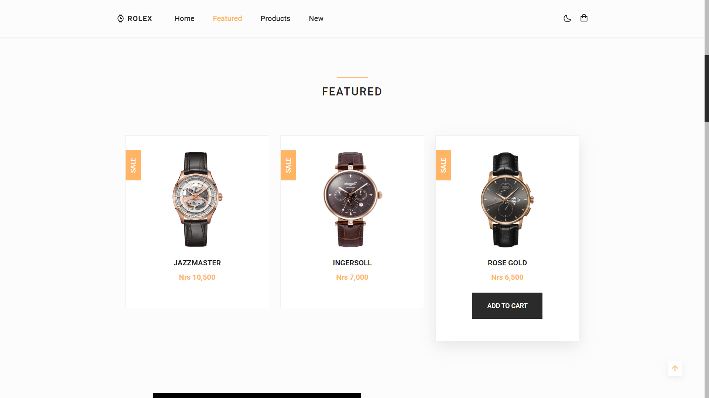
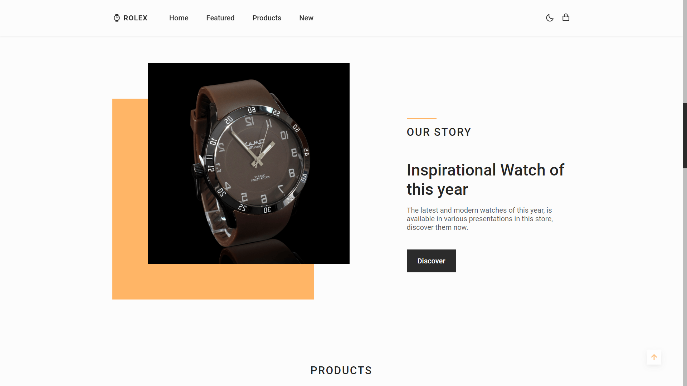
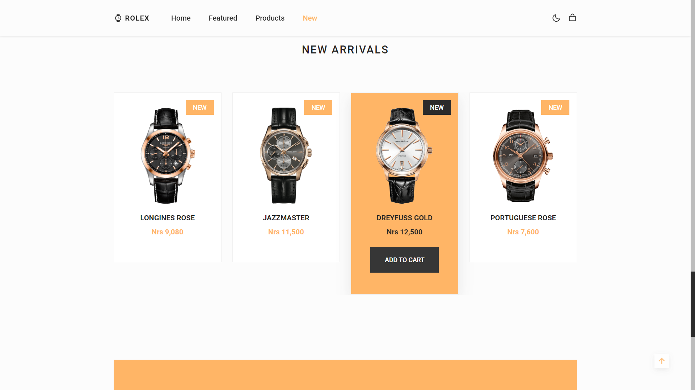

# Responsive Watches Website

A responsive product website for watches.

## Features

- Mobile-first layout
- Dark and light mode
- Smooth scrolling between sections
- Product carousel (Swiper)

## Run it

No build step. Open `index.html` in a browser, or serve the folder with any static server, for example `python -m http.server`.

## Credits

Built while following a Bedimcode YouTube tutorial.

## Screenshots

